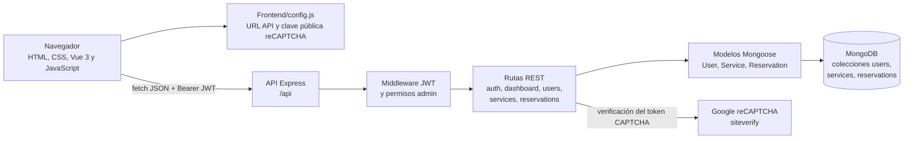

# Sistema de reservas

Aplicación web para que clientes creen y administren sus reservas de servicios, y para que administradores gestionen el catálogo y las cuentas. El repositorio contiene un frontend estático y una API REST Node.js que persiste los datos en MongoDB.

Las versiones declaradas en los manifiestos de Backend y Frontend son `1.0.0`. No se encontró una licencia publicada ni un workflow de CI activo; por eso no se agregan badges de licencia o build.

## Índice

- [Descripción](#descripción)
- [Características principales](#características-principales)
- [Tecnologías](#tecnologías)
- [Arquitectura](#arquitectura)
- [Modelo de datos](#modelo-de-datos)
- [Estructura del proyecto](#estructura-del-proyecto)
- [Requisitos e instalación](#requisitos-e-instalación)
- [Uso y configuración](#uso-y-configuración)
- [Diagnóstico de conexión](#diagnóstico-de-conexión)
- [API](#api)
- [Pruebas y despliegue](#pruebas-y-despliegue)
- [Contribución y licencia](#contribución-y-licencia)
- [Limitaciones conocidas](#limitaciones-conocidas)

## Descripción

El sistema centraliza el catálogo de servicios y la agenda de reservas de un negocio. Los clientes pueden crear una cuenta, consultar servicios y gestionar sus propias reservas. Los administradores pueden gestionar usuarios y servicios, y consultar estadísticas generales.

El frontend se sirve como archivos estáticos. La API y MongoDB son servicios separados: publicar el frontend en Vercel **no despliega** automáticamente la API.

## Características principales

### Visitantes y clientes

- Registrarse con nombre, correo, teléfono, contraseña y verificación reCAPTCHA. El registro crea la cuenta, inicia sesión y redirige al dashboard.
- Iniciar sesión con correo y contraseña. La sesión se guarda como JWT en `localStorage` y se redirige al dashboard.
- Consultar el dashboard, estadísticas y hasta cinco reservas recientes.
- Consultar servicios disponibles.
- Crear reservas, consultar el historial propio con filtros, reprogramar fecha/hora y cancelar reservas.

### Administradores

- Consultar estadísticas globales y las reservas recientes globales del dashboard. La API permite a un administrador listar todas las reservas con `?all=true`; la pantalla actual de reservas lista las propias.
- Crear, editar y desactivar usuarios; buscar por nombre/correo y filtrar por rol y estado.
- Crear, editar y desactivar servicios; buscar por texto, categoría y estado.
- El backend impide que el administrador se quite su propio rol o desactive su cuenta si es el último administrador activo.

El registro público asigna el rol `user`. El proyecto no incluye una creación automática de la primera cuenta administradora; el procedimiento de inicialización está en [Requisitos e instalación](#requisitos-e-instalación).

## Tecnologías

| Área | Tecnología y versión declarada | Uso |
|---|---|---|
| Lenguaje backend | JavaScript, CommonJS | API y acceso a datos |
| Runtime | Node.js `>=20` | Ejecución del backend, pruebas y verificaciones |
| Lenguajes frontend | HTML5, CSS y JavaScript | Interfaz web estática |
| UI frontend | Vue `3` cargado desde `unpkg.com` | Componentes y estado reactivo de las páginas |
| API HTTP | Express `^5.1.0` | Rutas REST y middleware |
| ODM / base de datos | Mongoose `^8.18.0` / MongoDB | Esquemas, índices y persistencia |
| Autenticación | `jsonwebtoken ^9.0.2`, `bcryptjs ^3.0.2` | JWT y hash de contraseñas |
| Configuración | `dotenv ^16.6.1` | Lectura de `Backend/.env` |
| Middleware HTTP | `cors ^2.8.5`, `helmet ^8.1.0`, `express-rate-limit ^8.1.0` | CORS, cabeceras y límite de solicitudes de autenticación |
| CAPTCHA | Google reCAPTCHA | Verificación de registros desde el backend |
| Pruebas API | `node:test`, `supertest ^7.1.4` | Pruebas HTTP con modelos simulados |
| Servidor frontend local | `serve` mediante `npx -y serve` | Servir los archivos estáticos en desarrollo |
| Despliegue frontend | Vercel, según `Frontend/vercel.json` | Publicación del frontend estático |

Las dependencias backend se administran con `Backend/package.json` y `Backend/package-lock.json`. El frontend no declara dependencias npm ni tiene un bundler; Vue se carga directamente desde CDN.

## Arquitectura

El frontend envía solicitudes HTTP JSON a la API. Las operaciones protegidas adjuntan el JWT como `Authorization: Bearer <JWT>`. Express enruta las solicitudes, los middleware comprueban autenticación/rol y los modelos Mongoose leen o escriben en MongoDB.



La API solo empieza a escuchar después de conectarse a MongoDB y preparar las colecciones e índices. El token de sesión, no los datos de negocio, se almacena en el navegador.

## Modelo de datos

Las tres colecciones se inicializan en el arranque; no se insertan documentos de ejemplo.

| Colección | Campos principales | Índices y comportamiento |
|---|---|---|
| `users` | `name`, `email`, `phone`, `passwordHash`, `legacyUserId`, `role`, `isActive`, `failedLoginAttempts`, `lockUntil`, `createdAt`, `updatedAt` | `email` es único. El hash de contraseña no se selecciona por defecto ni se devuelve al cliente. |
| `services` | `name`, `description`, `price`, `durationMinutes`, `imageUrl`, `category`, `status`, `createdAt`, `updatedAt` | Índice compuesto `status` + `category`. La baja lógica establece `status: inactive`. |
| `reservations` | `userId`, `serviceId`, `date`, `time`, `notes`, `status`, `createdAt`, `updatedAt` | `userId` y `serviceId` son referencias. Índices para `userId` + `date` y `serviceId` + `date` + `time` + `status`. |

`userId` apunta a un usuario y `serviceId` a un servicio. Las estadísticas del dashboard se calculan con consultas; no se guardan en una colección independiente.

## Estructura del proyecto

El árbol omite `node_modules` y `Backend/.env`, que es una configuración local ignorada por Git.

```text
.
├── .github/
│   └── workflows/
│       └── main.yml              # Archivo vacío; no define un workflow activo
├── .gitattributes                # Normalización de archivos de texto
├── .gitignore                    # Ignora node_modules, .env y dist
├── HISTORIAS_DE_USUARIO.md       # Historias HUS-01 a HUS-09 y criterios asociados
├── README.md                     # Esta guía
├── Backend/
│   ├── .env.example              # Plantilla de variables backend
│   ├── README.md                 # Guía breve del backend
│   ├── package.json              # Dependencias y scripts backend
│   ├── package-lock.json         # Versiones resueltas de dependencias backend
│   ├── src/
│   │   ├── app.js                # Configuración Express, CORS y montaje de rutas
│   │   ├── server.js             # Carga .env, conecta Mongo y arranca HTTP
│   │   ├── database/
│   │   │   └── initialize.js     # Crea colecciones e índices
│   │   ├── middleware/
│   │   │   └── authenticate.js   # Verificación JWT y rol administrador
│   │   ├── models/
│   │   │   ├── user.js           # Esquema de usuarios
│   │   │   ├── service.js        # Esquema de servicios
│   │   │   └── reservation.js    # Esquema de reservas y referencias
│   │   └── routes/
│   │       ├── auth.routes.js        # Registro, login y verificación CAPTCHA
│   │       ├── dashboard.routes.js   # Estadísticas
│   │       ├── users.routes.js       # Administración de usuarios
│   │       ├── services.routes.js    # Catálogo y administración de servicios
│   │       └── reservations.routes.js # Reservas
│   └── test/
│       ├── app.test.js          # CORS
│       ├── auth.test.js         # Registro, login y CAPTCHA
│       ├── dashboard.test.js    # Estadísticas y permisos
│       ├── models.test.js       # Esquemas
│       ├── users.test.js        # Gestión de usuarios
│       ├── services.test.js     # Gestión de servicios
│       └── reservations.test.js # Crear, consultar, actualizar y cancelar
└── Frontend/
    ├── api.js                   # Cliente común para dashboard y reservas
    ├── config.js                # API_BASE_URL y clave pública reCAPTCHA
    ├── dashboard.html           # Página del dashboard
    ├── dashboard.js             # Dashboard y flujos de reserva
    ├── index.html               # Página de inicio de sesión
    ├── login.js                 # Interfaz y envío del login
    ├── register.html            # Página de registro
    ├── register.js              # Formulario de registro y CAPTCHA
    ├── services.html            # Página de servicios
    ├── services.js              # Consulta y administración de servicios
    ├── users.html               # Página de gestión de usuarios
    ├── users.js                 # Gestión de usuarios para administradores
    ├── styles.css               # Estilos compartidos
    ├── package.json             # Scripts de desarrollo, build y pruebas
    ├── vercel.json              # Vercel estático: outputDirectory ., cleanUrls y trailingSlash
    └── test/
        └── api.test.js          # Pruebas del cliente de API frontend
```

No hay un `package.json` en la raíz: instala y ejecuta cada parte desde su carpeta. Tampoco se encontraron `Dockerfile`, `requirements.txt` ni manifiestos de otros lenguajes.

## Requisitos e instalación

### Requisitos previos

- Node.js 20 o superior y npm.
- Un cluster MongoDB Atlas o una instancia MongoDB accesible.
- Clave de sitio y clave secreta de reCAPTCHA para habilitar el registro.
- Un navegador con acceso a los CDN usados por el frontend.

### Clonar e instalar

Sustituye el usuario y el nombre del repositorio por la URL real:

```powershell
git clone https://github.com/<usuario>/<repositorio>.git
Set-Location .\<repositorio>

Set-Location .\Backend
npm ci
Copy-Item .env.example .env
```

Edita `Backend/.env` y completa las variables de backend. El archivo `.env` está excluido por `.gitignore`; no publiques sus valores.

| Variable | Requerida | Propósito |
|---|---:|---|
| `MONGODB_URI` | Sí | URI de conexión a MongoDB. El backend no usa una base local de respaldo si falta. |
| `MONGODB_DNS_SERVERS` | No | DNS para resolver registros `mongodb+srv`, separados por coma. Por defecto usa los DNS del sistema; configúrala solo si Node falla al resolver SRV. |
| `MONGODB_DB_NAME` | No | Base de datos; predeterminada: `Reservas`. |
| `JWT_SECRET` | Sí | Firma de tokens. Debe tener al menos 32 caracteres. |
| `PORT` | No | Puerto HTTP; predeterminado: `3000`. |
| `CLIENT_ORIGIN` | No | Origen u orígenes permitidos por CORS; predeterminado: `http://localhost:5500`. Admite varios separados por coma. |
| `RECAPTCHA_SECRET_KEY` | Sí para registrar | Clave privada que usa la API para verificar tokens con Google. |
| `LOGIN_MAX_ATTEMPTS` | No | Intentos fallidos antes del bloqueo temporal; predeterminado: `5`. |
| `LOGIN_LOCK_MINUTES` | No | Duración del bloqueo temporal; predeterminada: `15`. |

Genera un secreto JWT en PowerShell:

```powershell
node -e "console.log(require('crypto').randomBytes(32).toString('hex'))"
```

En `Frontend/config.js` configura:

- `API_BASE_URL`: URL base pública de la API. En local, el valor predeterminado es `http://localhost:3000`.
- `RESERVAS_RECAPTCHA_SITE_KEY`: clave pública de sitio, permitida en el navegador. No es la clave secreta del servidor.

En la consola de reCAPTCHA registra los dominios locales y de producción usados por el frontend. La clave de sitio y `RECAPTCHA_SECRET_KEY` deben corresponder al mismo sitio/clave.

### Primera cuenta administradora

El registro crea cuentas con rol `user`; el proyecto no crea una cuenta administradora ni credenciales de demostración. Para crear una cuenta administradora propia:

1. Registra una cuenta con tu propio correo y contraseña desde la página de registro.
2. En MongoDB Atlas, abre **Data Explorer** → base `Reservas` → colección `users`.
3. Busca el documento por tu correo y edítalo: cambia `role` de `user` a `admin` y confirma que `isActive` sea `true`.
4. Guarda el documento e inicia sesión con el correo y la contraseña que elegiste. El dashboard usa el mismo inicio para clientes y administradores.

No se incluyen contraseñas reales en este README. Nunca edites `passwordHash` manualmente ni compartas la contraseña de una cuenta administradora.

## Uso y configuración

Abre dos terminales desde la raíz del repositorio.

### Backend

```powershell
Set-Location .\Backend
npm run dev
```

`npm run dev` inicia Node.js con `--watch`. El backend conecta a MongoDB, crea las colecciones `users`, `services` y `reservations` si no existen, crea sus índices y escucha en `PORT` (por defecto `3000`).

Comprueba `http://localhost:3000/api/health`; la respuesta esperada es:

```json
{"status":"ok"}
```

### Frontend

En otra terminal:

```powershell
Set-Location .\Frontend
npm run dev
```

El script sirve `Frontend` en `http://localhost:5500`. `npm start` ejecuta el mismo comando. Para otro puerto u origen, configura `CLIENT_ORIGIN` en `Backend/.env` y reinicia el backend.

La configuración de Vercel en `Frontend/vercel.json` establece `outputDirectory: "."`, `cleanUrls: true` y `trailingSlash: false`.

### Scripts disponibles

| Carpeta | Comando | Resultado |
|---|---|---|
| `Backend` | `npm ci` | Instala exactamente las dependencias del lockfile |
| `Backend` | `npm run dev` | Ejecuta `node --watch src/server.js` |
| `Backend` | `npm start` | Ejecuta `node src/server.js` |
| `Backend` | `npm run build` | Comprueba sintaxis de `src/server.js` con `node --check`; no genera un bundle |
| `Backend` | `npm test` | Ejecuta las pruebas con `node --test` |
| `Frontend` | `npm run dev` / `npm start` | Ejecuta `npx -y serve -l 5500 .` |
| `Frontend` | `npm run build` | Comprueba sintaxis de los archivos JavaScript con `node --check`; no compila ni empaqueta |
| `Frontend` | `npm test` | Ejecuta `node --test test/*.test.js` |

### Ejecución publicada

El archivo `Frontend/vercel.json` configura una publicación estática con el directorio de salida `.`. Para una instalación pública:

1. Despliega el backend Node.js en un servicio compatible y configura allí las variables privadas de `Backend/.env`.
2. Configura `Frontend/config.js` con la URL HTTPS pública del backend y vuelve a publicar el frontend.
3. Define `CLIENT_ORIGIN` en el backend con el origen HTTPS exacto del frontend, sin ruta ni barra final.
4. Autoriza en MongoDB Atlas la conexión de red del proveedor backend.

Vercel no ejecuta la API Express con la configuración actual del frontend. Si `API_BASE_URL` conserva `localhost:3000`, el navegador de cada visitante buscará la API en su propio equipo, no en el servidor desplegado.

## Diagnóstico de conexión

El mensaje de conexión aparece cuando `fetch` no recibe una respuesta HTTP. Las causas típicas son URL incorrecta, API apagada, CORS o una llamada HTTP bloqueada desde una página HTTPS. Si la API sí responde `400`, `401`, `403` o `500`, se trata de un error distinto; la consola de red permite ver el estado y la respuesta.

El aviso de login/registro ahora muestra la URL de API que intentó usar y escribe el detalle técnico del fallo en la consola del navegador.

### Publicación en Vercel: frontend y backend

Vercel sirve los archivos estáticos de `Frontend`; el backend debe estar publicado aparte. En el código actual, la URL predeterminada es `http://localhost:3000`, que solo apunta al equipo del visitante. Sigue estos pasos:

1. **Publica la API en un servicio Node.js.** Por ejemplo, al crear un Web Service en Render desde el repositorio, selecciona `Backend` como *Root Directory*, `npm ci` como *Build Command* y `npm start` como *Start Command*. Usa Node.js 20 o superior. Otros proveedores deben ejecutar la carpeta `Backend` con el mismo comando de inicio.
2. **Añade las variables en el panel del proveedor backend.** Configura `MONGODB_URI`, `MONGODB_DB_NAME` (`Reservas`), `JWT_SECRET` (mínimo 32 caracteres), `CLIENT_ORIGIN` con el origen exacto del frontend Vercel y `RECAPTCHA_SECRET_KEY`. No configures un `PORT` fijo si el proveedor asigna uno automáticamente. No pegues secretos en archivos del frontend ni los subas a GitHub.
3. **Permite la conexión desde el backend a Atlas.** En *Network Access* de Atlas autoriza las direcciones IP de salida que documente tu proveedor. No uses `0.0.0.0/0` como solución permanente.
4. **Espera el arranque y verifica la API.** Abre `https://<dominio-backend>/api/health`. Debe responder `{"status":"ok"}`. Si no responde, revisa los logs del backend y confirma que conectó a MongoDB y que sus variables están completas.
5. **Apunta el frontend al backend.** En `Frontend/config.js`, reemplaza el valor local de `window.API_BASE_URL` por el dominio HTTPS real del backend, sin añadir `/api` ni una barra final:

   ```js
   window.API_BASE_URL = window.API_BASE_URL || "https://<dominio-backend>";
   ```

6. **Ajusta CORS.** En la variable `CLIENT_ORIGIN` del backend pon el origen de Vercel, por ejemplo `https://<proyecto>.vercel.app` (sin ruta ni barra final). Para permitir más de uno, sepáralos por coma; incluye el dominio personalizado de producción si lo usas.
7. **Verifica reCAPTCHA para el registro.** En la consola de Google agrega el dominio de Vercel a los dominios permitidos. La clave pública del frontend y `RECAPTCHA_SECRET_KEY` del backend deben pertenecer al mismo sitio reCAPTCHA. reCAPTCHA no interviene en el login.
8. **Guarda y despliega los cambios.** Confirma que Vercel use `Frontend` como directorio raíz del proyecto y vuelve a publicar. En *Network* de las herramientas de desarrollador, login/registro deben dirigirse a `https://<dominio-backend>/api/auth/...`, nunca a `localhost`.

### Ejecución local

1. En una terminal, entra en `Backend`, instala dependencias (`npm ci`) y completa `Backend/.env` con MongoDB, `JWT_SECRET` y las demás variables necesarias.
2. Ejecuta `npm run dev` dentro de `Backend`. Espera a que indique que la API está disponible.
3. Abre `http://localhost:3000/api/health` y confirma que responde `{"status":"ok"}`.
4. En otra terminal, ejecuta `npm run dev` dentro de `Frontend` y abre `http://localhost:5500`.
5. Si cambiaste los orígenes, configura `CLIENT_ORIGIN` para incluir el origen exacto, por ejemplo `http://localhost:5500`, y reinicia el backend.

Después de cambiar `Backend/.env`, detén completamente el backend con `Ctrl+C` y vuelve a ejecutar `npm run dev`; no dependas de que `node --watch` detecte cambios en `.env`.

Si Node muestra `ECONNREFUSED` al consultar `querySrv` aunque `Resolve-DnsName` funcione, añade a `Backend/.env` un DNS que permita consultas SRV y reinicia el backend:

```env
MONGODB_DNS_SERVERS=8.8.8.8,8.8.4.4
```

Usa solo un resolvedor DNS aprobado para tu red. Si después de resolver SRV aparece un error TLS o `MongooseServerSelectionError`, revisa en Atlas que el cluster esté activo y que *Network Access* permita la IP pública actual; comprueba también que VPN, firewall o antivirus no bloquee conexiones salientes al puerto `27017`. No abras Atlas a todas las IP como solución permanente.

### Cómo identificar el fallo

Abre las herramientas del navegador (F12), pestañas *Network* y *Console*, e intenta iniciar sesión:

| Observación | Causa probable / acción |
|---|---|
| La solicitud va a `http://localhost:3000` desde Vercel | `Frontend/config.js` conserva el valor local; cámbialo por la URL HTTPS publicada de la API. |
| `ERR_CONNECTION_REFUSED` o no hay respuesta | Backend apagado, host/puerto incorrecto o despliegue fallido; prueba `/api/health` y revisa logs. |
| Error de CORS en consola | El origen de la página no coincide exactamente con `CLIENT_ORIGIN`; actualiza la variable y reinicia/republica el backend. |
| Contenido mixto o bloqueo por HTTPS | El frontend HTTPS intenta llamar a una API HTTP; publica la API con HTTPS y usa esa URL en `config.js`. |
| `querySrv ECONNREFUSED` al arrancar Node | El resolvedor DNS preferido rechaza consultas directas de Node; configura `MONGODB_DNS_SERVERS` con un resolvedor permitido y reinicia. |
| Error TLS o `MongooseServerSelectionError` tras resolver SRV | Revisa que el cluster esté activo, agrega la IP actual en Atlas *Network Access* y comprueba el acceso saliente al puerto `27017`. |
| La solicitud recibe `401` o `403` | La API sí fue alcanzada; revisa credenciales, cuenta activa y permisos. |
| Login funciona, registro devuelve error | Revisa la clave secreta y los logs de verificación reCAPTCHA; el registro requiere CAPTCHA, el login no. |

## API

Base local: `http://localhost:3000`. Las solicitudes JSON deben usar `Content-Type: application/json`. Excepto el health check y las rutas de autenticación, las rutas requieren `Authorization: Bearer <JWT>`. El JWT dura una hora.

Las respuestas de error usan un objeto `{ "message": "..." }`. Los códigos habituales incluyen `400` (datos inválidos), `401` (sesión requerida, inválida o vencida), `403` (rol insuficiente), `404` (recurso no encontrado), `409` (duplicado o conflicto) y `500` (error interno). Registro y login comparten un límite de 10 solicitudes por IP cada 15 minutos.

### Salud

#### `GET /api/health`

No requiere autenticación.

```http
GET /api/health
```

```json
{"status":"ok"}
```

### Autenticación

#### `POST /api/auth/register`

Crea un usuario `user`, valida CAPTCHA y contraseña, y devuelve una sesión JWT para iniciar sesión automáticamente.

```json
{
  "name": "Ana Pérez",
  "email": "ana@correo.com",
  "phone": "3001234567",
  "password": "ClaveSegura123!",
  "confirmPassword": "ClaveSegura123!",
  "termsAccepted": true,
  "captchaToken": "<token de reCAPTCHA>"
}
```

Respuesta `201`:

```json
{
  "message": "Registro exitoso. Sesión iniciada.",
  "token": "<JWT>",
  "user": {
    "id": "<id>",
    "name": "Ana Pérez",
    "email": "ana@correo.com",
    "phone": "3001234567",
    "role": "user"
  }
}
```

#### `POST /api/auth/login`

```json
{
  "email": "ana@correo.com",
  "password": "ClaveSegura123!"
}
```

Respuesta `200`:

```json
{
  "message": "Inicio de sesión exitoso.",
  "token": "<JWT>",
  "user": {
    "id": "<id>",
    "name": "Ana Pérez",
    "email": "ana@correo.com",
    "role": "user"
  }
}
```

Contraseñas de registro: mínimo 8 caracteres, con mayúscula, minúscula, número y símbolo, y máximo 72 bytes. Se guardan con bcrypt. El inicio de sesión bloquea temporalmente cuentas tras varios intentos fallidos; ajusta `LOGIN_MAX_ATTEMPTS` y `LOGIN_LOCK_MINUTES`.

El registro también exige nombre de 2 a 100 caracteres, correo válido, teléfono válido, confirmación de contraseña, aceptación de términos y un token reCAPTCHA verificado por Google.

### Dashboard

#### `GET /api/dashboard/stats`

Requiere JWT. Los administradores obtienen conteos globales; los demás usuarios reciben sus propios conteos y reservas. `stats.users` es `null` para un usuario no administrador. La respuesta incluye hasta cinco reservas recientes.

```http
GET /api/dashboard/stats
Authorization: Bearer <JWT>
```

Respuesta `200`:

```json
{
  "user": {"id": "<id>", "name": "Ana Pérez", "role": "user"},
  "stats": {
    "users": null,
    "services": {"total": 8, "active": 6},
    "reservations": {
      "total": 2,
      "pending": 0,
      "confirmed": 1,
      "cancelled": 0,
      "completed": 1
    }
  },
  "recentReservations": [
    {
      "id": "<id>",
      "date": "2026-11-01T00:00:00.000Z",
      "time": "10:00",
      "status": "confirmed",
      "notes": "",
      "userId": "<id>",
      "serviceId": "<id>"
    }
  ]
}
```

### Usuarios

Todas las rutas `/api/users` requieren una cuenta activa con rol `admin`. `page` predeterminado: `1`; `limit` predeterminado: `20`, máximo: `100`.

#### `GET /api/users`

Filtros opcionales: `search` (nombre/correo), `role` (`user` o `admin`) y `status` (`active` o `inactive`).

```http
GET /api/users?page=1&limit=20&search=ana&role=user&status=active
Authorization: Bearer <JWT de administrador>
```

```json
{
  "users": [
    {
      "id": "<id>",
      "name": "Ana Pérez",
      "email": "ana@correo.com",
      "phone": "3001234567",
      "role": "user",
      "isActive": true,
      "createdAt": "2026-11-01T00:00:00.000Z"
    }
  ],
  "pagination": {"page": 1, "limit": 20, "total": 1, "totalPages": 1}
}
```

#### `POST /api/users`

Crea una cuenta desde el panel de administración. `phone` es opcional; `role` admite `user` o `admin` y por defecto es `user`.

La contraseña sigue la misma política de fortaleza que el registro. Las contraseñas y los hashes nunca se incluyen en la respuesta.

```json
{
  "name": "Luis Gómez",
  "email": "luis@correo.com",
  "phone": "3011234567",
  "password": "ClaveSegura123!",
  "role": "user"
}
```

Respuesta `201`:

```json
{
  "message": "Usuario creado correctamente.",
  "user": {
    "id": "<id>",
    "name": "Luis Gómez",
    "email": "luis@correo.com",
    "phone": "3011234567",
    "role": "user",
    "isActive": true,
    "createdAt": "2026-11-01T00:00:00.000Z"
  }
}
```

#### `PUT /api/users/:id`

Actualiza parcialmente `name`, `email`, `phone`, `role` o `isActive`. No acepta cambios directos de contraseña o hash.

```http
PUT /api/users/<id>
Authorization: Bearer <JWT de administrador>
Content-Type: application/json

{"name":"Luis Gómez"}
```

Respuesta `200`:

```json
{
  "message": "Usuario actualizado correctamente.",
  "user": {
    "id": "<id>",
    "name": "Luis Gómez",
    "email": "luis@correo.com",
    "phone": "3011234567",
    "role": "user",
    "isActive": true,
    "createdAt": "2026-11-01T00:00:00.000Z"
  }
}
```

#### `DELETE /api/users/:id`

Desactiva la cuenta (`isActive: false`); no borra el documento ni el historial.

```http
DELETE /api/users/<id>
Authorization: Bearer <JWT de administrador>
```

Respuesta `200`:

```json
{
  "message": "Usuario desactivado correctamente.",
  "user": {
    "id": "<id>",
    "name": "Luis Gómez",
    "email": "luis@correo.com",
    "phone": "3011234567",
    "role": "user",
    "isActive": false,
    "createdAt": "2026-11-01T00:00:00.000Z"
  }
}
```

### Servicios

Todas las rutas `/api/services` requieren JWT. Un usuario activo puede consultar; crear, actualizar y desactivar requiere `admin`. `page` predeterminado: `1`; `limit`: `20`, máximo: `100`.

#### `GET /api/services`

Filtros opcionales: `search` (nombre, descripción o categoría), `status` (`active` / `inactive`) y `category`.

```http
GET /api/services?page=1&limit=20&search=corte&status=active&category=Cabello
Authorization: Bearer <JWT>
```

```json
{
  "services": [
    {
      "id": "<id>",
      "name": "Corte",
      "description": "Corte clásico",
      "price": 25000,
      "durationMinutes": 30,
      "imageUrl": "",
      "category": "Cabello",
      "status": "active",
      "createdAt": "2026-11-01T00:00:00.000Z",
      "updatedAt": "2026-11-01T00:00:00.000Z"
    }
  ],
  "pagination": {"page": 1, "limit": 20, "total": 1, "totalPages": 1}
}
```

#### `POST /api/services`

Requiere administrador. `name`, `price` y `durationMinutes` son obligatorios; los demás campos son opcionales.

El nombre admite hasta 100 caracteres; `price` debe ser un número mayor o igual a cero; `durationMinutes`, un entero positivo. `description`, `imageUrl` y `category` admiten texto de hasta 500 caracteres. `status` solo admite `active` o `inactive`.

```json
{
  "name": "Corte",
  "description": "Corte clásico",
  "price": 25000,
  "durationMinutes": 30,
  "imageUrl": "https://ejemplo.com/corte.jpg",
  "category": "Cabello",
  "status": "active"
}
```

Respuesta `201`:

```json
{
  "message": "Servicio creado correctamente.",
  "service": {
    "id": "<id>",
    "name": "Corte",
    "description": "Corte clásico",
    "price": 25000,
    "durationMinutes": 30,
    "imageUrl": "https://ejemplo.com/corte.jpg",
    "category": "Cabello",
    "status": "active",
    "createdAt": "2026-11-01T00:00:00.000Z",
    "updatedAt": "2026-11-01T00:00:00.000Z"
  }
}
```

#### `PUT /api/services/:id`

Requiere administrador. Actualiza parcialmente `name`, `description`, `price`, `durationMinutes`, `imageUrl`, `category` o `status`.

```http
PUT /api/services/<id>
Authorization: Bearer <JWT de administrador>
Content-Type: application/json

{"price":30000,"status":"inactive"}
```

Respuesta `200`:

```json
{
  "message": "Servicio actualizado correctamente.",
  "service": {
    "id": "<id>",
    "name": "Corte",
    "description": "Corte clásico",
    "price": 30000,
    "durationMinutes": 30,
    "imageUrl": "",
    "category": "Cabello",
    "status": "inactive",
    "createdAt": "2026-11-01T00:00:00.000Z",
    "updatedAt": "2026-11-02T00:00:00.000Z"
  }
}
```

#### `DELETE /api/services/:id`

Requiere administrador. Realiza una baja lógica (`status: inactive`) y conserva el documento.

```http
DELETE /api/services/<id>
Authorization: Bearer <JWT de administrador>
```

Respuesta `200`:

```json
{
  "message": "Servicio eliminado correctamente.",
  "service": {
    "id": "<id>",
    "name": "Corte",
    "description": "Corte clásico",
    "price": 25000,
    "durationMinutes": 30,
    "imageUrl": "",
    "category": "Cabello",
    "status": "inactive",
    "createdAt": "2026-11-01T00:00:00.000Z",
    "updatedAt": "2026-11-02T00:00:00.000Z"
  }
}
```

### Reservas

Todas las rutas `/api/reservations` requieren JWT. Los estados posibles en el modelo son `pending`, `confirmed`, `cancelled` y `completed`.

#### `POST /api/reservations`

Crea una reserva para el usuario autenticado. `serviceId`, `date` y `time` son obligatorios; `time` usa `HH:mm`; `notes` admite hasta 500 caracteres. La reserva inicial queda en estado `confirmed`. Se rechaza (`409`) otra reserva no cancelada del mismo servicio, fecha y hora exactas.

```json
{
  "serviceId": "<id de servicio>",
  "date": "2026-11-20",
  "time": "10:30",
  "notes": "Primera visita"
}
```

Respuesta `201`:

```json
{
  "message": "Reserva agendada exitosamente.",
  "reservation": {
    "id": "<id>",
    "userId": "<id de usuario>",
    "serviceId": "<id de servicio>",
    "service": {
      "id": "<id de servicio>",
      "name": "Corte",
      "price": 25000,
      "durationMinutes": 30,
      "category": "Cabello"
    },
    "date": "2026-11-20T00:00:00.000Z",
    "time": "10:30",
    "notes": "Primera visita",
    "status": "confirmed",
    "createdAt": "2026-11-18T00:00:00.000Z",
    "updatedAt": "2026-11-18T00:00:00.000Z"
  }
}
```

#### `GET /api/reservations`

Filtros opcionales: `page`, `limit` (máximo `100`), `status`, `startDate` y `endDate`. Los usuarios consultan solo sus reservas. Los administradores también consultan las propias por defecto; `?all=true` permite consultar todas y `?my=true` fuerza el filtro propio.

```http
GET /api/reservations?page=1&limit=10&status=confirmed&startDate=2026-11-01&endDate=2026-11-30
Authorization: Bearer <JWT>
```

Respuesta `200`:

```json
{
  "reservations": [
    {
      "id": "<id>",
      "userId": "<id de usuario>",
      "serviceId": "<id de servicio>",
      "service": {
        "id": "<id de servicio>",
        "name": "Corte",
        "price": 25000,
        "durationMinutes": 30,
        "category": "Cabello"
      },
      "date": "2026-11-20T00:00:00.000Z",
      "time": "10:30",
      "notes": "Primera visita",
      "status": "confirmed",
      "createdAt": "2026-11-18T00:00:00.000Z",
      "updatedAt": "2026-11-18T00:00:00.000Z"
    }
  ],
  "pagination": {"page": 1, "limit": 10, "total": 1, "totalPages": 1}
}
```

#### `PUT /api/reservations/:id`

El propietario o un administrador puede actualizar parcialmente `date`, `time` y `notes`. No se pueden reprogramar reservas canceladas; el nuevo horario vuelve a comprobarse.

```http
PUT /api/reservations/<id>
Authorization: Bearer <JWT>
Content-Type: application/json

{"date":"2026-11-21","time":"11:00","notes":"Cambio de hora"}
```

Respuesta `200`:

```json
{
  "message": "Reserva actualizada exitosamente.",
  "reservation": {
    "id": "<id>",
    "userId": "<id de usuario>",
    "serviceId": "<id de servicio>",
    "service": {
      "id": "<id de servicio>",
      "name": "Corte",
      "price": 25000,
      "durationMinutes": 30,
      "category": "Cabello"
    },
    "date": "2026-11-21T00:00:00.000Z",
    "time": "11:00",
    "notes": "Cambio de hora",
    "status": "confirmed",
    "createdAt": "2026-11-18T00:00:00.000Z",
    "updatedAt": "2026-11-18T00:10:00.000Z"
  }
}
```

#### `PATCH /api/reservations/:id/cancel`

El propietario o un administrador puede cancelar una reserva no cancelada. El documento se conserva y el horario vuelve a estar disponible.

```http
PATCH /api/reservations/<id>/cancel
Authorization: Bearer <JWT>
```

Respuesta `200`:

```json
{
  "message": "Reserva cancelada exitosamente y horario liberado.",
  "reservation": {
    "id": "<id>",
    "userId": "<id de usuario>",
    "serviceId": "<id de servicio>",
    "service": {
      "id": "<id de servicio>",
      "name": "Corte",
      "price": 25000,
      "durationMinutes": 30,
      "category": "Cabello"
    },
    "date": "2026-11-20T00:00:00.000Z",
    "time": "10:30",
    "notes": "Primera visita",
    "status": "cancelled",
    "createdAt": "2026-11-18T00:00:00.000Z",
    "updatedAt": "2026-11-18T00:15:00.000Z"
  }
}
```

## Pruebas y despliegue

Ejecuta cada suite desde su carpeta:

```powershell
Set-Location .\Backend
npm test
npm run build

Set-Location ..\Frontend
npm test
npm run build
```

Las pruebas backend sustituyen los modelos por dobles de prueba; no necesitan conectarse a MongoDB. Los scripts `build` solo validan sintaxis JavaScript, no producen artefactos compilados.

`.github/workflows/main.yml` está vacío, por lo que actualmente no hay jobs de GitHub Actions que ejecuten pruebas o despliegues. El frontend tiene configuración estática para Vercel; no hay una configuración de despliegue del backend en este repositorio.

## Contribución y licencia

Para contribuir, crea una rama descriptiva, realiza un cambio acotado, ejecuta las pruebas de Backend y Frontend y abre un pull request con el comportamiento observado y los comandos de validación.

No se encontró `LICENSE` ni una declaración de licencia en los manifiestos. **TODO:** el propietario del proyecto debe elegir y añadir una licencia antes de redistribuirlo.

## Limitaciones conocidas

- No hay recuperación de contraseña ni verificación de correo implementadas.
- La primera cuenta administradora debe configurarse manualmente en la base de datos después del registro.
- El botón de servicios confirma una eliminación permanente en la interfaz, aunque la API solo desactiva el servicio. **TODO:** alinear el texto de confirmación con la baja lógica.
- No existe un proceso de migración automática ni datos de ejemplo/seed en el repositorio.
